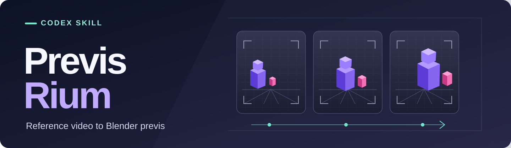
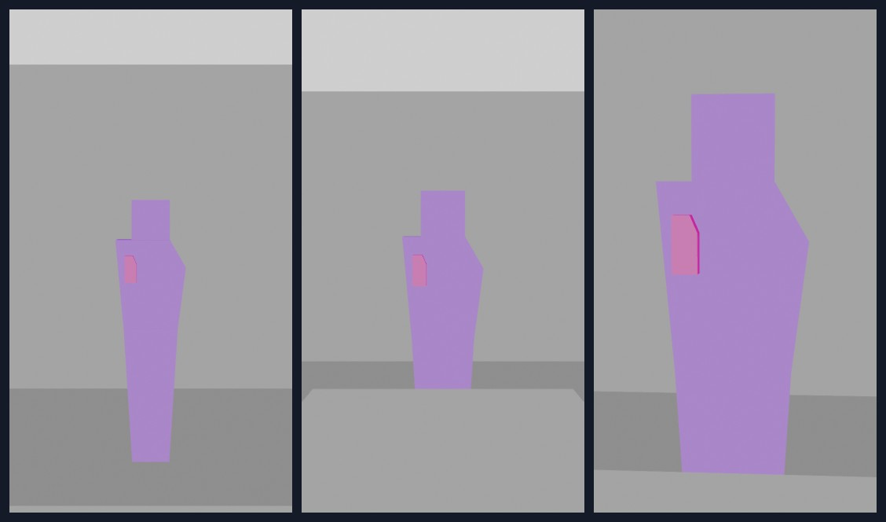

<p align="center">
  
</p>

<h1 align="center">Previs Rium</h1>

<p align="center">
  <strong>영상 생성 전에 구도와 동선을 미리 맞추세요.</strong><br>
  원본 영상의 카메라, 피사체 배치, 컷 타이밍을 Blender 3D 프리비즈로 옮기는 Codex 스킬입니다.
</p>

<p align="center">
  <a href="https://github.com/contentriumkorea/Previs-Rium/releases/latest"></a>
  <a href="#적용-범위와-제한"></a>
  <a href="DISTRIBUTION.md"></a>
</p>

<p align="center">
  <a href="#빠르게-시작하기">설치하기</a> ·
  <a href="https://github.com/contentriumkorea/Previs-Rium/releases/latest/download/previs-rium.zip">다운로드</a> ·
  <a href="#사용-모습">사용 모습</a> ·
  <a href="#적용-범위와-제한">상세 안내</a>
</p>

---

## 빠르게 시작하기

Codex와 Blender 4.2 이상, FFmpeg·FFprobe, Python 3, Pillow가 필요합니다.

<a href="https://github.com/contentriumkorea/Previs-Rium/releases/latest/download/previs-rium.zip"></a>

1. ZIP을 풀어 **previs-rium** 폴더를 `~/.codex/skills/`에 넣습니다.
2. 새 Codex 채팅에서 **$previs-rium**을 선택합니다.
3. 원본 영상과 인물·제품·장소 참조 이미지를 첨부합니다.

[상세 설치 및 업데이트 안내 →](#설치-및-배포)

## 핵심 기능

| 01 · 원본 연출 분석 | 02 · 3D 프리비즈 제작 | 03 · 생성용 자료 정리 |
| :--- | :--- | :--- |
| **카메라와 컷을 확인** | **연출을 생성 전에 점검** | **프롬프트와 참조를 한곳에** |
| 컷 경계와 대표 프레임을 추출합니다. | Blender에서 구도·동선을 만들고 원본과 나란히 비교합니다. | 씨댄스용 프롬프트, 이미지 첨부 순서, 화면 설정을 정리합니다. |

## 사용 모습

<p align="center">
  
</p>

**프리비즈에서 카메라와 배치를 먼저 확인합니다.** 인물과 제품은 색으로 구분한 단순 도형으로 표시합니다.

<details>
<summary><strong>Blender로 렌더한 예제 프레임 보기</strong></summary>

공개 패키지의 예제 명세를 4초로 줄여 Blender에서 렌더한 프레임입니다. 보라색은 인물, 마젠타색은 제품입니다.



</details>

## 설치 및 배포

| 방식 | 사용 방법 |
| :--- | :--- |
| [공식 설치 ZIP](https://github.com/contentriumkorea/Previs-Rium/releases/latest/download/previs-rium.zip) | ZIP 안의 `previs-rium` 폴더를 Codex의 사용자 스킬 폴더 `~/.codex/skills/`에 넣습니다. |
| 기존 설치 업데이트 | 스킬 폴더의 개인 수정 사항을 먼저 백업합니다. 최신 ZIP의 `previs-rium` 폴더로 교체한 뒤 새 Codex 채팅을 엽니다. |
| [릴리스 및 변경 사항](https://github.com/contentriumkorea/Previs-Rium/releases/latest) | 최신 버전의 안내와 설치 ZIP을 확인할 수 있습니다. |

## 이렇게 사용하세요

```text
$previs-rium 첨부한 영상의 카메라, 인물 동선, 컷 타이밍을 Blender 프리비즈로 옮겨줘.
인물과 제품은 참조 이미지를 각각 사용하고, 첫 렌더는 원본과 나란히 비교해줘.
```

## 적용 범위와 제한

- 입력은 원본 영상과 참조 이미지입니다. 결과는 Blender 프리비즈, 비교 영상, 씨댄스용 전달 자료입니다. 외부 영상 생성은 사용자가 직접 진행합니다.
- Windows의 Microsoft Store판 Blender 5.3.0으로 헤드리스 렌더를 확인했습니다. 해당 실행기는 완료 로그를 전달하지 않아 스킬의 MP4 변환이 중단될 수 있습니다.
- macOS와 Linux에서는 이번 배포의 렌더 흐름을 검증하지 않았습니다.

<details>
<summary><strong>상세 안내와 검증 범위</strong></summary>

- ZIP을 풀었을 때 `previs-rium/SKILL.md`가 보여야 합니다. `previs-rium` 폴더 아래에 같은 이름의 폴더가 한 번 더 들어가지 않도록 설치하세요.
- [스킬 사용 흐름](previs-rium/SKILL.md) · [렌더 명세 예제](previs-rium/assets/previz_spec_example.json) · [전달 자료 형식](previs-rium/references/handoff.md)

</details>

<details>
<summary><strong>English overview</strong></summary>

Previs Rium is a Codex skill that turns a reference video's framing, blocking, and cut timing into Blender 3D previs. It prepares a comparison video and a Seedance handoff with prompts and reference upload order. Download the skill ZIP, place the `previs-rium` folder in `~/.codex/skills/`, and invoke `$previs-rium` in a new Codex chat. The Microsoft Store build of Blender can render frames headlessly, but its launcher may prevent the skill from continuing to MP4 encoding.

</details>

---

<p align="center">
  <strong>Contentrium</strong><br>
  <a href="DISTRIBUTION.md">원본 출처 및 재배포 안내</a> ·
  <a href="https://github.com/contentriumkorea/Previs-Rium/releases/latest">최신 릴리스</a>
</p>

<sub>원본 스킬 bantomak-previs는 반토막AI의 공개 재배포 허락을 받아 제공합니다.</sub>

<p align="center">
  <a href="https://contentrium.com/"></a>
</p>
